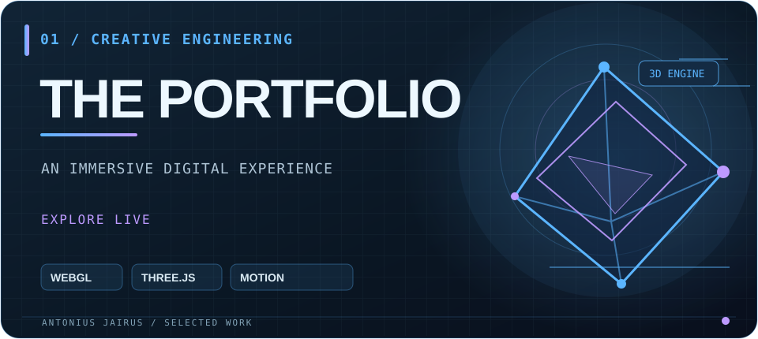
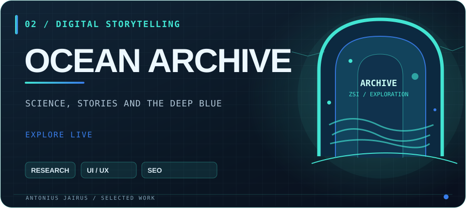
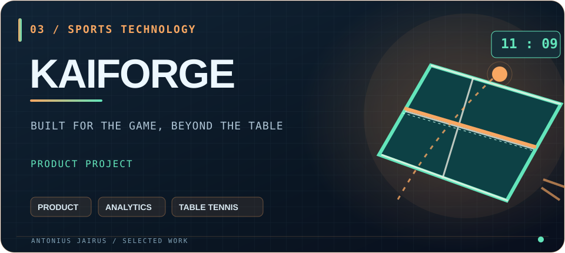
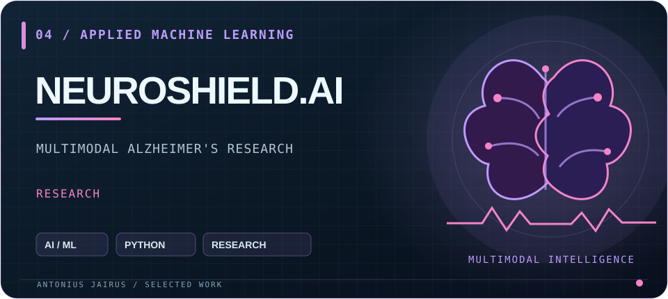
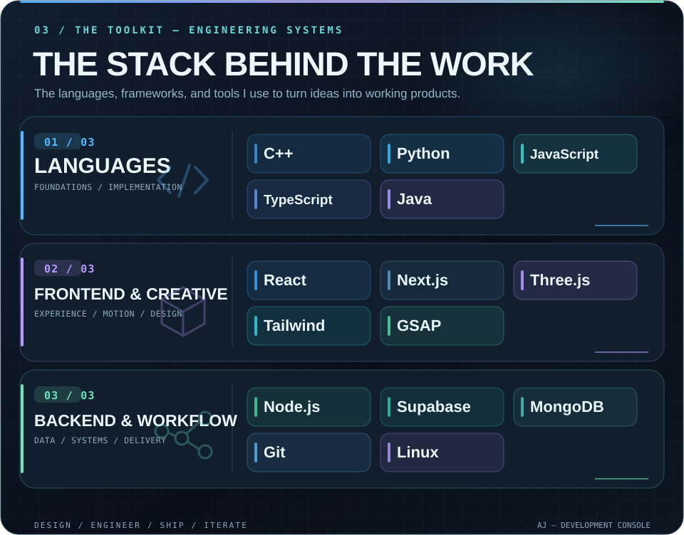
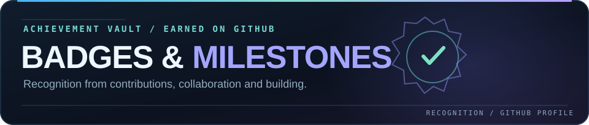

 

### ENGINEER BY DISCIPLINE. BUILDER BY INSTINCT.

**Full-Stack Development · Creative Engineering · AI/ML**

I turn ideas into functional products, immersive interfaces,  
and digital experiences that feel memorable.

---

I'm **Antonius Jairus R**, a Computer Science engineering student  
specializing in Cybersecurity at Sri Krishna College of Engineering and Technology.

I work at the intersection of **engineering, design, product thinking, and experimentation**.

From immersive 3D portfolio experiences to real-world management systems,  
I like building things that people can actually use.

---

<table>
<tr>
<td width="50%" valign="top">

**A portfolio you experience, not just scroll.**

Spatial storytelling, interactive motion and experimental 3D built for the web.

[**Enter the experience ↗**](https://antoniusjairus.in)
</td>
<td width="50%" valign="top">

**Research, preserved as an experience.**

An interactive archive highlighting the scientific work of Dr. J. S. Yogesh Kumar.

[**Explore the archive ↗**](https://yogesh-teal.vercel.app/)
</td>
</tr>
<tr>
<td width="50%" valign="top">

**The training ground, reimagined in software.**

A table-tennis product built around sessions, matches, tournaments and player analytics.

INDEPENDENT PRODUCT · UNDER ITERATION
</td>
<td width="50%" valign="top">

**Research at the intersection of AI and neuroscience.**

Exploring multimodal machine learning approaches to Alzheimer's disease research.

AI RESEARCH · TEAM PROJECT
</td>
</tr>
</table>

---

---

<table>
<tr>
<td width="34%" align="center" valign="top">

**YOLO**

GITHUB ACHIEVEMENT

Merged a pull request without a review.

</td>
<td width="34%" align="center" valign="top">

**QUICKDRAW**

GITHUB ACHIEVEMENT

Closed an issue or pull request shortly after opening it.

</td>
<td width="32%" align="center" valign="top">

 

  

**GITHUB PRO**

PROFILE HIGHLIGHT

My GitHub Pro account badge.

</td>
</tr>
</table>

Achievements earned on GitHub. Select an achievement to view its official profile details.

---

**PROOF OF WORK. NOT PROMISES.**

Blue marks the quieter days; cyan and mint show higher contribution intensity. The custom chart refreshes automatically and carries the **exact date and contribution count** for each square. Open the original SVG to see its built-in date labels and tooltips.

#### THE KOI / CODE IN MOTION

A living pixel-art koi influenced by public contributions, languages and streaks.

BUILD · COMMIT · EVOLVE

---

Original repository highlights, linked directly from this custom README.

<table><tr>
<td width="50%" valign="top">

#### [portfolio](https://github.com/antoniusjairus4/portfolio)

Immersive 3D web development, creative interactions and experiments.

[**See the repository ↗**](https://github.com/antoniusjairus4/portfolio)

</td><td width="50%" valign="top">

#### [Data Structures & Algorithms](https://github.com/antoniusjairus4/Data-Structures-Algorithm-and-Design-Techniques)

C++ implementations and systematic problem-solving practice.

[**See the repository ↗**](https://github.com/antoniusjairus4/Data-Structures-Algorithm-and-Design-Techniques)

</td></tr></table>

---

I enjoy building ambitious ideas, experimental interfaces,  
and products with real-world impact.

**Have a challenging idea? Let's create something worth using.**

 

DESIGNED TO BUILD. DRIVEN TO IMPROVE.

**Ship · Learn · Repeat.**

