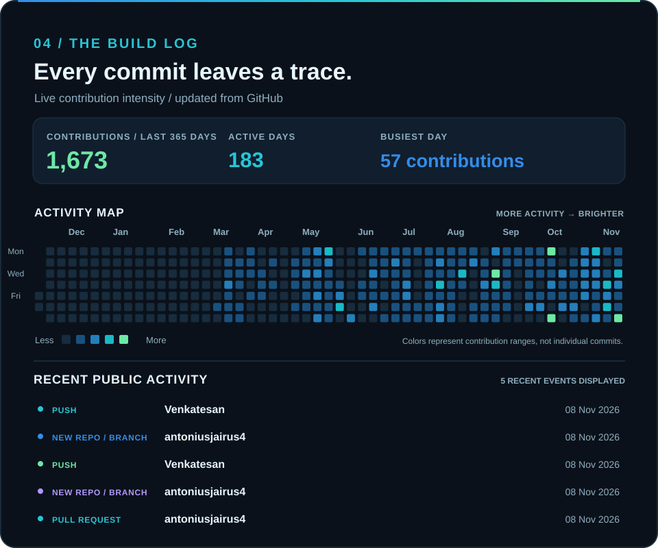
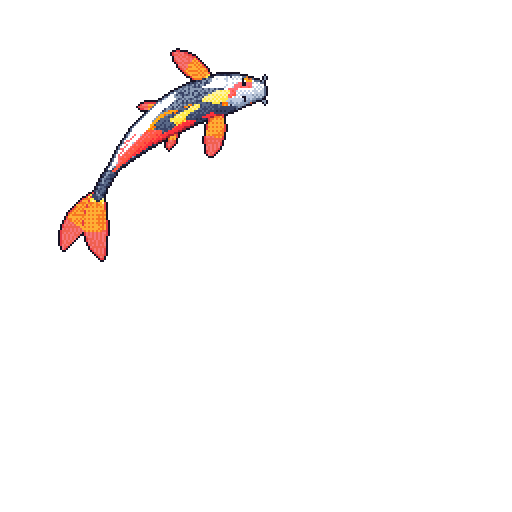

 

### ENGINEER BY DISCIPLINE. BUILDER BY INSTINCT.

**Full-Stack Development · Creative Engineering · AI/ML**

I turn ideas into functional products, immersive interfaces,  
and digital experiences that feel memorable.

---

### `01 / THE BUILDER`

I'm **Antonius Jairus R**, a Computer Science engineering student  
specializing in Cybersecurity at Sri Krishna College of Engineering and Technology.

I work at the intersection of **engineering, design, product thinking, and experimentation**.

From immersive 3D portfolio experiences to real-world management systems,  
I like building things that people can actually use.

> Less talking about what I can build.  
> More showing what I've shipped.

---

### `02 / SELECTED WORK`

<table>
<tr>
<td width="50%" valign="top">

#### 01 — PERSONAL PORTFOLIO

**An immersive 3D experience**

A creative portfolio exploring WebGL, motion,  
spatial interactions, and experimental web design.

`Creative Development` `3D` `WebGL`

[**Explore Website ↗**](https://antoniusjairus.in)

</td>
<td width="50%" valign="top">

#### 02 — SCIENTIFIC ARCHIVE

**Research meets digital storytelling**

A digital archive for Dr. J. S. Yogesh Kumar,  
bringing scientific research, underwater imagery,  
and career milestones into an interactive experience.

`Web Development` `UI/UX` `SEO`

[**Explore Website ↗**](https://yogesh-teal.vercel.app/)

</td>
</tr>

<tr>
<td width="50%" valign="top">

#### 03 — CHIT FUND SYSTEM

**Real-world financial operations**

An administration platform designed to simplify  
chit group management, installments, auctions,  
and member records.

`React` `PWA` `Management System`

[**Explore Application ↗**](https://venkatesan-nine.vercel.app/)

</td>
<td width="50%" valign="top">

#### 04 — NEUROSHIELD.AI

**AI-assisted Alzheimer's research**

Exploring machine learning and multimodal  
medical data to support research into early  
Alzheimer's disease prediction.

`Python` `Machine Learning` `Research`

**Research Project**

</td>
</tr>
</table>

---

### `03 / THE TOOLKIT`

**LANGUAGES**

 

**FRONTEND & CREATIVE**

 

**BACKEND & TOOLS**

---

### `04 / THE BUILD LOG`

**PROOF OF WORK. NOT PROMISES.**

A live contribution calendar in ocean blue, turquoise, and mint. Each square reflects your daily GitHub activity; higher contribution levels appear brighter. Refreshed automatically.

 

#### THE KOI / CODE IN MOTION

A pixel-art koi shaped by the languages, activity, and streaks behind the work. Recreated daily from public GitHub contributions.

 

BUILD · COMMIT · EVOLVE

---

### `05 / OPEN TO COLLABORATION`

I enjoy building ambitious ideas, experimental interfaces,  
and products with real-world impact.

**Have something interesting in mind? Let's build it.**

 

DESIGNED TO BUILD. DRIVEN TO IMPROVE.

**Ship · Learn · Repeat.**

